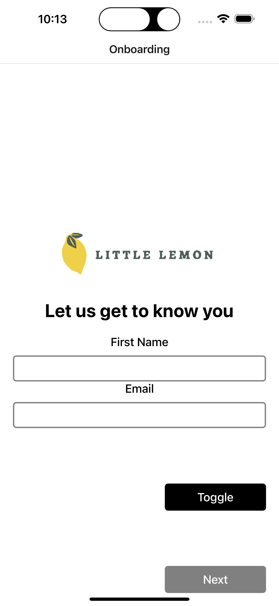
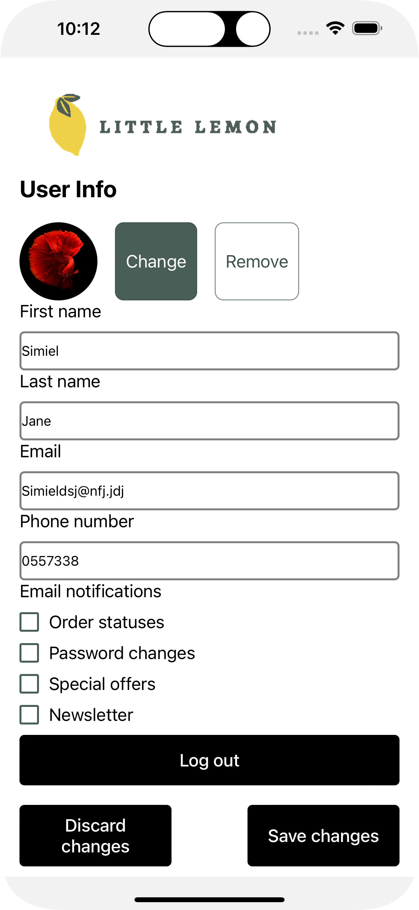

# Little Lemon

Little Lemon is a cross-platform mobile client for a family-owned Mediterranean restaurant. A guest enters a first name and email once, then browses a delivery menu, searches and filters dishes on the device, and keeps a local profile with a photo and notification preferences. This repository is a Coursera capstone: the on-device database is named `coursera.db`, and the menu comes from the public dataset published for Meta's mobile-developer coursework.

## Features

- **Onboarding.** First name and email are required. Next stays disabled until both fields have a value. Submitting stores that profile and opens the menu.
- **Persisted onboarding.** The onboarded flag and profile are saved with Zustand and AsyncStorage. A later launch opens the menu directly until the guest logs out.
- **Menu home.** The home screen shows the Little Lemon logo, the restaurant description, and dishes grouped into starters, mains, and desserts. Each row shows the name, description, price, and image.
- **Search and category filters.** Search waits 500ms after typing, then matches dish names. Chips limit the list to starters, mains, and desserts. With no chip selected, every category is included. Both filters query the on-device database.
- **Menu cache.** The first successful load creates a `menuitems` table, downloads the remote menu, and inserts it into SQLite. Later launches read those rows.
- **Profile.** The profile screen edits first name, last name, email, and phone number, and stores four notification preferences: order statuses, password changes, special offers, and newsletter. A photo can be chosen from the media library; otherwise the avatar shows initials. Save stays disabled until the name, phone, and email fields pass the on-screen checks. The profile, including those preferences, stays on the device.
- **Logout.** Log out clears the stored profile and returns to onboarding.
- **Navigation.** A native stack shows onboarding until the guest is onboarded, then Home and Profile. Profile hides the default stack header.

The home screen is headed "ORDER FOR DELIVERY!" and lists dishes for that menu. Placing an order is outside this codebase: there is no cart or checkout.

## Tech stack

- **Expo SDK 50** and **React Native 0.73** with **React 18**
- **TypeScript**, extending Expo's base `tsconfig`
- **React Navigation 6** native stack
- **Zustand 4** persist middleware with **AsyncStorage**
- **expo-sqlite** for the menu cache
- **React Native Paper** for the search field
- **expo-image-picker** and **expo-checkbox**
- **lodash** `debounce` for search

`app.json` sets a portrait layout, a light interface, iOS tablet support, an Android adaptive icon, and a web favicon. npm scripts start the same app for Android, iOS, and web.

## Project structure

```
App.tsx                    Stack navigator gated on the onboarded flag
screens/Onboarding.tsx     First-run first name and email
screens/Home.tsx           Menu fetch, search, filters, and section list
screens/Profile.tsx        Profile form, avatar, notification preferences, logout
components/FilterBar.tsx   Category chips for starters, mains, and desserts
contexts/AuthContext.ts    Persisted Zustand store for onboarding and profile
database.ts                SQLite open, create, insert, and filtered select
utils.ts                   Section grouping and useUpdateEffect
assets/                    App icon, splash, adaptive icon, and favicon
Frame1.png, Frame3.png     Design frames for the menu home and profile form
```

`useUpdateEffect` runs the search and filter query only after the first render, so the initial cache load and later filter updates stay on separate paths. `getSectionListData` turns flat menu rows into sections keyed by category.

## Getting started

### Prerequisites

- Node.js and npm
- A place to run the Expo dev server: an Android emulator or device, an iOS simulator for the `ios` script, or a browser for web

### Install

```bash
npm install
```

### Environment variables

None. The menu URL is fixed in `screens/Home.tsx`, and profile data stays in on-device storage.

### Run

```bash
npm start          # expo start
npm run android    # expo start --android
npm run ios        # expo start --ios
npm run web        # expo start --web
```

`package.json` defines these four scripts. It does not define a test script or a production-build script.

The first launch needs network access so the menu can be downloaded from `https://raw.githubusercontent.com/Meta-Mobile-Developer-PC/Working-With-Data-API/main/capstone.json`. Dish images are loaded from that repository's `images/` path. After a successful save, the menu is read from `coursera.db`.

## Project status

Coursework capstone. The app implements the Little Lemon client against Meta's published capstone menu and the design frames in this repository (`Frame1.png`, `Frame3.png`).

## What this demonstrates

- A navigation stack gated by a persisted onboarded flag, with logout returning the app to the first-run screen
- A remote JSON menu cached in SQLite and queried on device for debounced name search and category filters
- Flat menu rows reshaped into a `SectionList` grouped by category
- A profile form that requests media-library permission, falls back to initials, validates fields before save, and persists the result with the onboarding flag
- A compact Expo layout that separates screens, a shared filter component, the database module, and the client store, with Android, iOS, and web entry scripts

## Design frames

These files are design frames checked into the repository. They are references for the menu home and the profile form, not captures of a running build.





Built by Samuel Mensah ([@simiel](https://github.com/simiel)).
